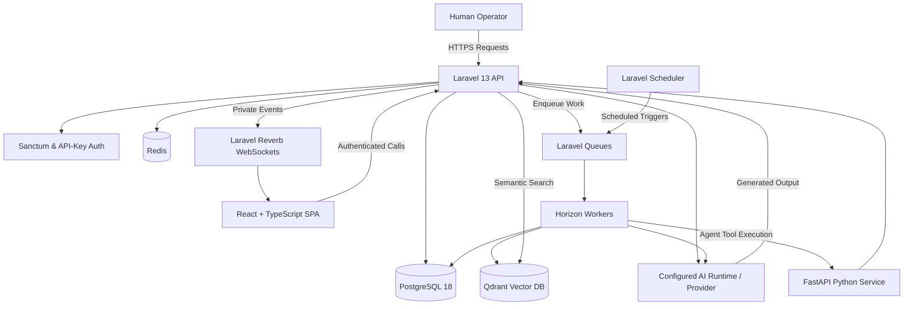

# Engineering Case Study: Self-Hosted AI Orchestration & RAG Platform

## 1. System Overview & Business Problem

This platform provides a web-based control plane for configuring AI assistants, managing knowledge sources, orchestrating multi-step workflows, and reviewing generated outputs. It addresses the engineering challenge of unifying model inference, vector retrieval, asynchronous execution, and human-in-the-loop oversight within a modular monorepo capable of both self-hosted and cloud-connected deployments.

## 2. Infrastructure & Tech Stack

- **Backend:** PHP 8.3+, Laravel 13, Laravel Sanctum, Laravel AI SDK, Laravel Horizon, Laravel Reverb (WebSockets), Spatie Laravel Permission.
- **Frontend:** React 18, TypeScript, Vite, Material UI, TanStack Query, Zustand, React Router, Laravel Echo.
- **Database & Vector Search:** PostgreSQL 18 (relational persistence), Redis (queues and caching), Qdrant (dedicated vector search engine).
- **Queues & Agent Workers:** Laravel Queues with Redis and Horizon supervision, Laravel Scheduler, and a dedicated Python microservice built with FastAPI, Uvicorn, Pydantic, and HTTPX.
- **DevOps & Testing:** Docker Compose (Laravel Sail), PHPUnit 12, Playwright (E2E browser testing), ESLint, TypeScript strict build checks.

## 3. Core Architectural Decisions

### 3.1 Provider-agnostic AI runtime abstraction

**Challenge:** Model capabilities, latency profiles, and hosting constraints evolve rapidly. Coupling application features directly to a single inference vendor creates high migration costs and prevents air-gapped or local inference deployments.

**Solution:** The backend encapsulates model connections and inference paths behind the Laravel AI SDK and configurable runtime registries, complemented by a FastAPI Python service for specialized agent execution. Deployment configuration selects between hosted APIs or self-hosted runtimes without modifying domain logic.

**Technical Impact:** Inference providers become an operational configuration concern, enabling seamless switching between cloud and local models while centralizing capability validation and error normalization.

### 3.2 Retrieval-Augmented Generation (RAG) with dedicated vector storage

**Challenge:** Large knowledge bases cannot fit within single prompt context windows, and document lifecycles require granular indexing, updating, and purging without corrupting relational integrity.

**Solution:** Document metadata and ownership reside in PostgreSQL, while chunked embeddings and semantic search operations are offloaded to Qdrant. Backend APIs expose explicit ingestion, re-indexing, scoping, and deletion workflows synchronized with vector store collections.

**Technical Impact:** Separating transactional persistence from high-dimensional vector search allows independent scaling and low-latency semantic retrieval while maintaining strict tenant/workspace scoping on search queries.

### 3.3 Queue-backed workflows and scheduled execution

**Challenge:** Document chunking, embedding generation, and chained AI workflows are computationally expensive and subject to external API rate limits, making synchronous HTTP execution unviable.

**Solution:** Workflow execution and knowledge ingestion are decoupled into asynchronous jobs supervised by Laravel Horizon, alongside scheduled background triggers managed by the Laravel Scheduler.

**Technical Impact:** Interactive dashboard responsiveness remains decoupled from long-running AI pipelines, with built-in retry policies, backoff strategies, and job state tracking.

### 3.4 Explicit authentication boundaries and private real-time channels

**Challenge:** The system serves both human operators via a Single-Page Application and external programmatic consumers via REST APIs, requiring distinct credential lifecycles and private real-time streaming.

**Solution:** Interactive dashboard sessions authenticate via Laravel Sanctum, while external integrations authenticate through scoped API keys. Real-time execution progress and streaming responses are delivered over private WebSocket channels authorized via Laravel Reverb.

**Technical Impact:** Clear credential boundaries simplify key rotation and access auditing while providing immediate visual feedback during multi-step workflow execution.

## 4. System Architecture Diagram

## 5. Quality Assurance & Deployment

* **Unit & Feature Testing:** PHPUnit 12 separates isolated unit tests (model capabilities, context builders, vector scoping) from full feature tests (API contracts, workflow runs, knowledge ingestion) utilizing in-memory SQLite and synchronous queue drivers for deterministic execution.
* **End-to-End & Static Checks:** Playwright validates critical browser workflows (authentication, navigation, knowledge management), while ESLint and `tsc` enforce strict TypeScript type safety prior to bundling.
* **Containerized Topology:** Docker Compose provisions the PHP runtime, PostgreSQL, Redis, Qdrant, and Reverb with persistent storage volumes, health checks, and automated restart policies for reproducible self-hosted deployments.

