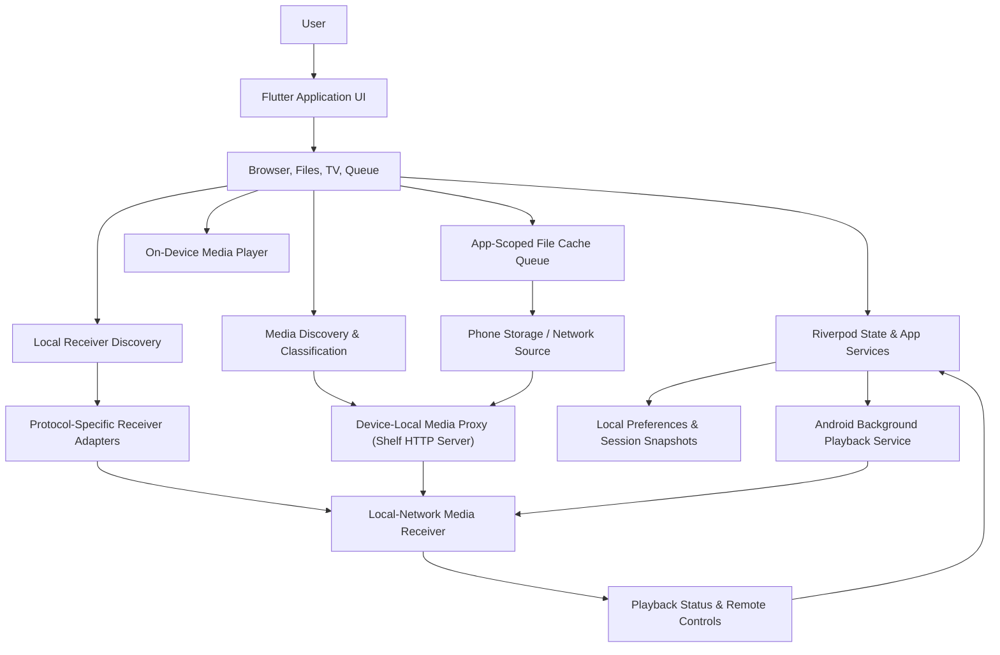

# Engineering Case Study: LAN Media Playback and Casting Client

## 1. System Overview & Business Problem

This Android-first, Flutter application unifies browser-discovered media, local device files, and live playlists into a single on-device playback and casting experience. It addresses the interoperability gap between diverse media sources and heterogeneous local-network receivers without requiring a centralized application backend, allowing seamless fallback to local playback when no network receiver is available.

## 2. Infrastructure & Tech Stack

- **Frontend / Runtime:** Dart 3, Flutter, Riverpod (reactive state management), `go_router`, `flutter_inappwebview`, `video_player`.
- **Media & Network Integration:** Pure-Dart casting implementations, HTTP, Multicast DNS, DLNA helper libraries, and `shelf` for device-local HTTP serving and proxying.
- **Persistence & Caching:** `shared_preferences`, `flutter_secure_storage`, `path_provider`, and an app-scoped file staging cache.
- **Workers & Background Services:** Riverpod-managed cache queues and Android background-service integration for playback/session continuity.
- **DevOps & Release Tooling:** Flutter CLI, `flutter_test`, Gradle Kotlin DSL, Java 17, with automated APK/App Bundle shell scripting and release minification/resource shrinking.

## 3. Core Architectural Decisions

### 3.1 Protocol adapters behind a shared casting domain

**Challenge:** Receivers on a local network expose differing discovery, connection, and control protocols. Coupling UI components directly to each protocol implementation creates high state complexity.

**Solution:** A modular casting abstraction separates protocol-agnostic concepts (device, media, session, discovery) from protocol-specific implementations. Discovery providers and session factories adapt receiver protocols to a unified control surface consumed by app features.

**Technical Impact:** UI workflows share common playback controls while protocol-specific quirks are isolated behind standardized interfaces, simplifying the integration of new receiver types.

### 3.2 Device-local media proxy and HTTP delivery

**Challenge:** Local network receivers often cannot access phone-internal storage directly, match the phone's network security context, or supply required headers for remote stream retrieval.

**Solution:** The application embeds a lightweight local HTTP server (`shelf`) to proxy remote playlists and serve staged local or network files over the local network. Media routing is mediated entirely on-device without cloud dependencies.

**Technical Impact:** Receivers fetch media via standard HTTP endpoints accessible within the local subnet, maximizing hardware compatibility while keeping data handling local and privacy-respecting.

### 3.3 Heuristic media URL classification

**Challenge:** Browser-scraping hooks observe a chaotic mix of complete media files, live manifests, metadata chunks, and individual streaming fragments, risking invalid payloads sent to receivers.

**Solution:** A dedicated URL classifier evaluates media formats and route shapes, categorizes media kinds, filters out raw transport fragments, and deduplicates variants before passing typed candidates to the casting UI.

**Technical Impact:** Protects receiver endpoints from invalid requests and provides clean, structured media choices to the user through heuristics and automated test coverage.

### 3.4 App-scoped preparation and durable background state

**Challenge:** File staging, downloads, and media preparation can easily outlive individual screen navigation events or foreground UI lifecycles.

**Solution:** Queue and cache states are managed globally via Riverpod providers with app-wide ownership, paired with Android background services to maintain session continuity during interruptions.

**Technical Impact:** Prevents task cancellation when users navigate away from active screens, ensuring predictable background processing and state recovery.

### 3.5 Explicit connection readiness and serialized remote commands

**Challenge:** Initial network discovery or socket connection does not guarantee that a receiver is ready to accept media commands, leading to race conditions and command drops.

**Solution:** Casting flows require explicit media-channel readiness checks before executing commands, serializing competing load requests and using bounded reconnect attempts with sequence invalidation.

**Technical Impact:** Guarantees deterministic command ordering and robust recovery from transient network drops, insulating the user experience from local network instability.

## 4. System Architecture Diagram

## 5. Quality Assurance & Deployment

* **Automated Testing:** Flutter unit and widget tests cover media classification, queue/cache resilience states, error handling, and routing logic, supported by protocol-level mock server tests in the casting package.
* **Static Analysis & Build Pipeline:** Enforces strict Dart lint rules (`flutter_lints`) and static analysis, compiled via automated shell scripts into production Android artifacts with code shrinking and secure key-properties signing isolation.
