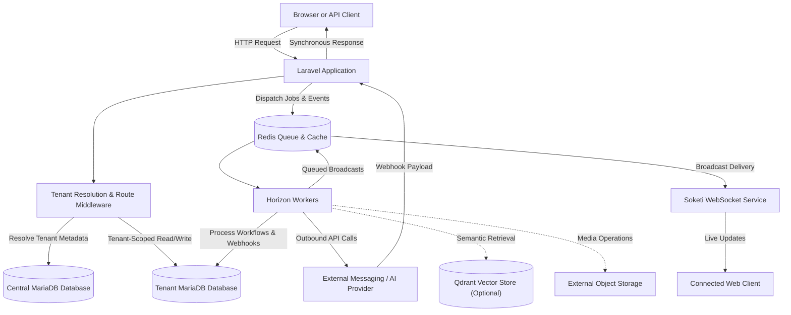

# Engineering Case Study: Multi-Tenant Omnichannel Messaging and Automation Platform

## 1. System Overview & Business Problem

This system provides a shared application platform for organizations to manage customer conversations across messaging channels, automate repeatable workflows, and integrate AI-assisted responses. It addresses the engineering challenge of serving multiple independent workspaces while orchestrating inbound webhooks, outbound provider APIs, asynchronous background processing, and real-time user interfaces within a single deployable architecture.

## 2. Infrastructure & Tech Stack

- **Backend:** PHP 8.4, Laravel 13, Laravel Sanctum (API authentication), Stancl Tenancy (tenant lifecycle and context isolation), Livewire, Scribe (OpenAPI documentation).
- **Frontend:** Blade templates, Livewire, Flux UI components, Vite 6, Tailwind CSS 4, Axios, Laravel Echo.
- **Database, Caching & Search:** MariaDB 10.11 (central and dynamically routed tenant connections), Redis (queues and distributed cache), Qdrant (vector search workloads).
- **Queues, Workers & Realtime:** Laravel Horizon 5 with Redis queue routing for distinct message/event categories, Soketi (WebSocket/Pusher-compatible server), Laravel Event Broadcasting.
- **External Integrations:** Abstracted boundaries for AI inference providers, cloud object storage, payment gateways, and mobile push-notification services.
- **DevOps & Testing:** Docker Compose, PHPUnit (unit and feature suites), Playwright (browser end-to-end testing), Laravel Pint, GitHub Actions CI with automated deployment pipelines.

## 3. Core Architectural Decisions

### 3.1 Database-per-tenant isolation with a shared central control plane

**Challenge:** A multi-tenant platform must serve multiple organizations without allowing one workspace's records, files, or cached state to bleed into another, while retaining a central control plane to resolve tenant identity and manage global metadata.

**Solution:** The application pairs a central database connection with dynamically configured tenant connections. Tenant HTTP routes initialize context from the request host and reject central-host access, while tenancy bootstrappers automatically scope database connections, cache prefixes, storage paths, and queue payloads. Tenant migrations are maintained and executed independently from central schema migrations.

**Technical Impact:** Tenant isolation is enforced at the request-lifecycle boundary rather than relying on manual query scoping in controllers. Dedicated tenant databases establish a strict data boundary and simplify tenant-level backups or compliance operations, balanced against structured provisioning and migration orchestration.

### 3.2 Distinct ingress paths for webhooks and authenticated application APIs

**Challenge:** Third-party messaging webhooks require predictable, low-latency acknowledgment (`200 OK`) to prevent provider retry storms, whereas interactive API operations require strict tenant context, authorization, and feature-level access control.

**Solution:** Inbound webhook route groups are decoupled from standard tenant API rate limiters and governed by dedicated, higher-threshold limiters. Authenticated API groups enforce tenant storage middleware, dual-authentication guards, and feature gates. Inbound webhook payloads are immediately validated and dispatched to asynchronous worker queues.

**Technical Impact:** Ingress policies are tailored to caller characteristics, preventing routine API throttling from dropping critical external provider events while maintaining strict authorization boundaries for tenant operations.

### 3.3 Redis-backed asynchronous processing with workload-specific queues

**Challenge:** Webhook ingestion, multi-step workflow execution, media processing, and external API calls exhibit variable latency and cannot block the synchronous HTTP request/response cycle.

**Solution:** Laravel's queue abstraction is backed by Redis and supervised by Laravel Horizon. Broadcast events and background jobs are routed to dedicated named queues based on workload priority, preserving serialized tenant context across asynchronous worker boundaries.

**Technical Impact:** Heavy workloads scale and retry independently without degrading interactive response times, providing granular operational visibility into queue throughput and worker capacity.

### 3.4 Event-based real-time updates

**Challenge:** Collaborative conversation interfaces require sub-second UI updates without continuous HTTP polling, while keeping socket transport mechanics decoupled from core business logic.

**Solution:** Domain events implement Laravel broadcasting interfaces routed through Redis queues to a Soketi WebSocket server. The frontend subscribes to authorized private tenant channels via Laravel Echo.

**Technical Impact:** Real-time state propagation remains asynchronous and non-blocking for HTTP handlers, ensuring responsive UI synchronization across active workspace sessions.

### 3.5 Layered authentication and feature authorization

**Challenge:** A multi-tenant platform must support both interactive user sessions and programmatic service integrations, with capabilities gated by organization tier.

**Solution:** Route definitions separate public/webhook ingress from protected tenant APIs. Authenticated route groups layer Sanctum token validation, permission checks, and feature-flag middleware at the routing boundary rather than relying solely on client-side visibility.

**Technical Impact:** Authentication, tenant resolution, and feature entitlement are expressed as composable middleware pipelines, ensuring uniform security enforcement across all endpoints.

## 4. System Architecture Diagram

## 5. Quality Assurance & Deployment

* **Automated Testing:** PHPUnit separates Unit and Feature suites with dedicated central and tenant-aware test base classes. Playwright executes Chromium end-to-end test suites covering authenticated and guest flows with failure traces and screenshots.
* **Continuous Integration:** GitHub Actions provisions MariaDB services, enforces code formatting via Laravel Pint, and runs isolated test suites before artifact promotion.
* **Containerization & Deployment:** Docker Compose orchestrates the application runtime alongside MariaDB, Redis, and Soketi. Deployment pipelines enforce SSH preflight checks, automated test gates, and controlled release stages with environment-injected secrets.
