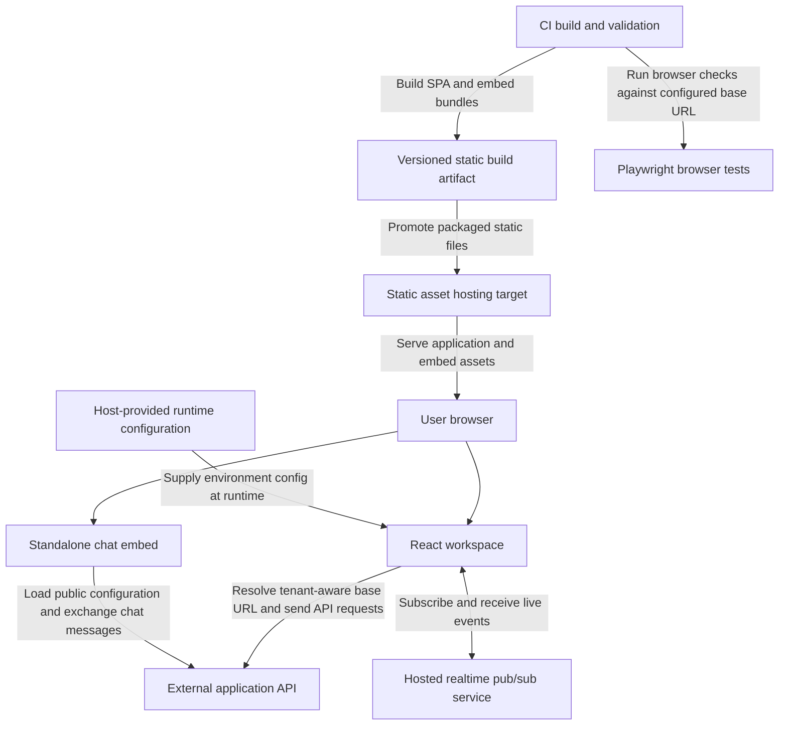

# Engineering Case Study: Omnichannel Customer Engagement Workspace

## 1. System Overview & Business Problem

This browser-based workspace brings customer conversations, team workflows, channel operations, and assistant tooling into a single operational interface. It is designed to support account-aware teams that need both responsive real-time updates and configurable, embeddable customer-facing chat experiences; this repository contains the frontend and delivery tooling, not the backend services or data stores.

## 2. Infrastructure & Tech Stack

The inventory below reflects dependencies and build/deployment configuration in this repository. Backend infrastructure not represented here is intentionally described generically.

- **Backend:** No backend framework or server-side application is defined in the main project manifest. The frontend calls an external API service; server-side implementation details are not part of this codebase.
- **Frontend:** JavaScript, React 18, React Router, Material UI, Vite. The application also builds standalone chat embed assets.
- **Client state and data access:** Redux Toolkit with Redux Thunk for application state and asynchronous actions; TanStack Query for server-state capabilities; Axios for HTTP requests; browser storage for selected client-side state.
- **Database / caching:** No database, server cache, or persistence service dependency is declared. IndexedDB support is available through a browser-storage library; its presence does not establish a backend data-store architecture.
- **Queues / workers:** No queue broker or background-worker runtime is defined in this repository. Asynchronous client requests and browser event handling are not server-side workers.
- **Realtime:** A hosted publish/subscribe client and Laravel Echo-compatible client support live connection and event handling. The realtime service itself is external to this repository.
- **DevOps / testing:** Node.js and Vite build tooling; a Dockerfile; a staged CI pipeline that builds static assets, packages an artifact, and transfers it to a web-hosting target; ESLint and Prettier; Node-based focused tests and Playwright end-to-end tests across desktop and mobile browser profiles.
- **Developer tooling:** A separate Node.js package contains Model Context Protocol and browser-automation integrations; it is kept outside the main app dependency bundle.

## 3. Core Architectural Decisions

### 3.1 Explicit client state domains

**Challenge ->** A unified interface spans conversations, users, permissions, workspace settings, connected channels, and presentation state. Scattering related state across component trees would make updates difficult to coordinate and reason about.

**Solution ->** A Redux Toolkit store composes feature-oriented slices for these domains, while React context and hooks provide narrower access where appropriate. TanStack Query is also installed for server-state concerns, separating the application's state-management tools by use case rather than placing all state in one mechanism.

**Technical Impact ->** Feature boundaries make updates and async flows easier to locate, while shared state supports coordinated views and notifications. The trade-off is a broad state surface: teams need conventions around which data belongs in Redux, query state, or component-local state to avoid duplicated sources of truth.

### 3.2 Tenant-aware API resolution and runtime configuration

**Challenge ->** The same compiled frontend must operate across account-specific contexts and deployment environments without embedding environment-specific service addresses into the static bundle.

**Solution ->** The HTTP client resolves its API base URL at request time using a tenant-aware URL utility and the current host context, attaches the available bearer credential, and centralizes response handling. A build helper inserts a runtime configuration script reference so the hosting application can supply environment configuration after deployment.

**Technical Impact ->** One static artifact can be promoted across environments, and tenant context can influence API routing without rebuilding per tenant. This places important trust boundaries in URL resolution and runtime config delivery; these values must be validated and the backend must independently enforce tenant authorization.

### 3.3 Real-time event handling separated from UI rendering

**Challenge ->** Live conversation and notification events must update multiple channel views without requiring users to refresh or tying connection mechanics to individual screens.

**Solution ->** A top-level realtime client coordinates channel naming, connection lifecycle, and event-handler registration. Event processing is delegated to a channel manager; Redux state is used to reflect resulting updates, while browser notification and reconnect feedback are managed alongside the connection lifecycle.

**Technical Impact ->** A shared connection layer avoids duplicating subscriptions across pages and allows incoming events to update global conversation state. The design has to manage subscription cleanup, reconnects, and event ordering carefully; the repository also exposes a delayed connection-loss notification rather than treating connection status as a blocking page failure.

### 3.4 Separate standalone embed artifacts from the application bundle

**Challenge ->** A customer-facing chat widget must be distributable into third-party pages without requiring those pages to load the full authenticated workspace or its entire dependency graph.

**Solution ->** Dedicated Vite library builds create self-contained IIFE assets for a launcher-based widget and a full-page embed experience. Their lightweight DOM UI, styling, public configuration lookup, and chat-session logic are isolated under the embed module and emitted to a separate output directory.

**Technical Impact ->** The embed surface can be integrated independently of the main SPA and avoids coupling host pages to the workspace's component runtime. The deliberate standalone implementation means shared behavior and styling need explicit compatibility testing across both embed modes.

### 3.5 Build once, validate, and promote a static artifact

**Challenge ->** Large frontend bundles are costly to rebuild and transfer during deployment, and configuration tied to a single environment makes promotion less reliable.

**Solution ->** The CI definition runs a deployment preflight where applicable, installs locked dependencies, builds the application and embed assets, injects the runtime-config entry point, checks the expected build output, then packages static files into a compressed artifact. A later deployment stage transfers and extracts that artifact to the hosting target. Vite also defines manual chunks for major dependency families to keep large feature libraries in separate bundles.

**Technical Impact ->** Build and deployment are separate stages, with a single packaged artifact passed between them and an early check for an unavailable deploy target. Runtime configuration supports environment promotion, while dependency chunking offers more control over bundle loading. The checked-in Dockerfile provides a Node-based container definition, but the CI pipeline is the clearest evidenced production delivery path; this repository does not establish a production container orchestration model.

## 4. System Architecture Diagram

The diagram shows only integrations evidenced by this frontend repository. It does not imply a particular database, backend framework, queue, or internal topology.

## 5. Quality Assurance & Deployment

- **Focused tests:** Numerous Node-based tests exercise isolated behavior such as workflow graph validation, API URL resolution, message composition, configuration parsing, and error presentation. They are invoked through individual package scripts; a single aggregate test command is not defined in the root manifest.
- **End-to-end tests:** Playwright tests cover application flows, permissions, responsive appearance, and realtime-related UI scenarios. Configuration includes Chromium, Firefox, and WebKit desktop projects as well as mobile browser profiles; CI retries and captures traces/screenshots on failure.
- **Static checks:** ESLint and Prettier are configured. The package scripts expose linting, formatting, and translation checks.
- **Deployment:** CI builds and verifies the static output, injects the runtime configuration hook, packages the files, and transfers the artifact in a separate deployment stage. Production deployment is serialized through a deployment resource group. Environment-specific endpoint values and credentials are not included in this case study.
