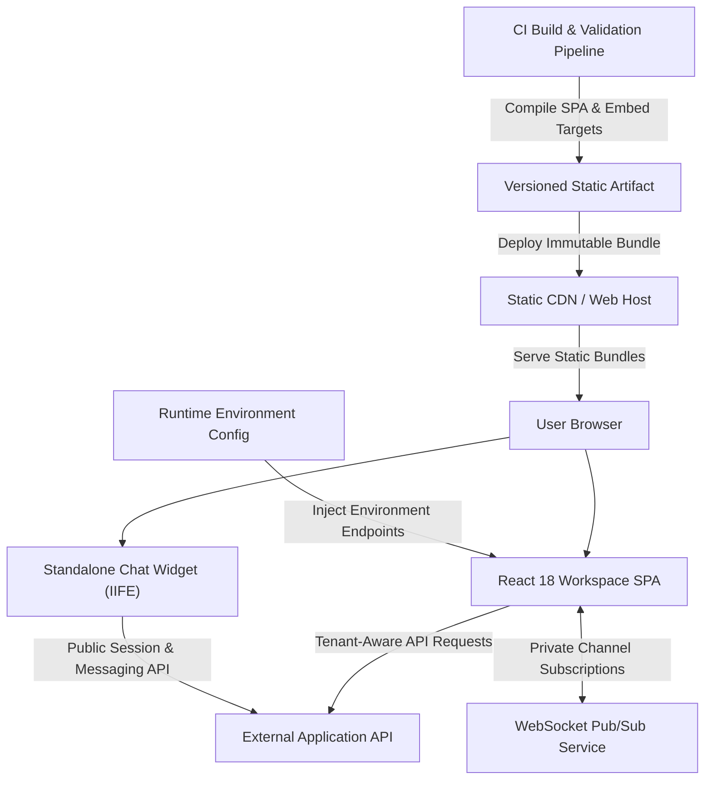
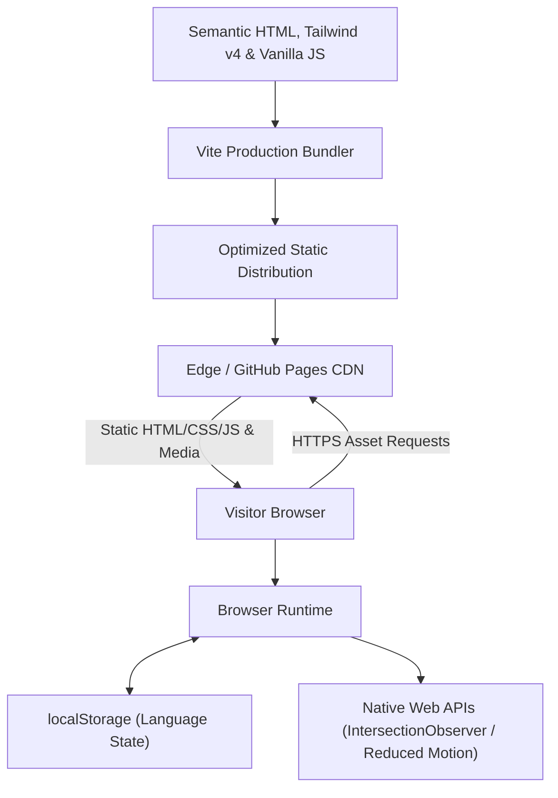

# Engineering Case Study: Omnichannel Customer Engagement Workspace

## 1. System Overview & Business Problem

This browser-based workspace unifies customer conversations, team workflows, channel configurations, and AI assistant tooling into a single operational interface. It addresses the frontend engineering challenge of delivering real-time multi-channel state synchronization alongside lightweight, embeddable customer chat widgets from a single modular codebase.

## 2. Infrastructure & Tech Stack

- **Frontend Core:** JavaScript (ES6+), React 18, React Router, Material UI, Vite.
- **State & Data Fetching:** Redux Toolkit (with Redux Thunk), TanStack Query, Axios, IndexedDB / browser storage.
- **Realtime Communication:** Laravel Echo and Pusher-compatible WebSocket client.
- **Build, CI/CD & Testing:** Vite multi-target bundler (SPA + IIFE embeds), ESLint, Prettier, Node.js test runner, Playwright (multi-browser desktop and mobile E2E testing).

## 3. Core Architectural Decisions

### 3.1 Domain-sliced client state management

**Challenge:** A unified agent workspace manages concurrent conversations, user permissions, workspace settings, and real-time notifications. Unstructured component state leads to prop-drilling, race conditions, and inconsistent UI views.

**Solution:** Client state is partitioned into feature-oriented Redux Toolkit slices for global real-time domains (active conversations, presence, notifications), while TanStack Query manages server-state caching, background refetching, and pagination.

**Technical Impact:** Clear separation between ephemeral UI/realtime state and cached server resources eliminates duplicate sources of truth and simplifies debugging across complex views.

### 3.2 Tenant-aware API resolution and runtime configuration

**Challenge:** A single compiled static bundle must operate across multiple tenant subdomains and deployment environments without hardcoding environment-specific endpoints at build time.

**Solution:** The Axios HTTP client dynamically resolves API base URLs at request time using host-context utilities and attaches bearer credentials. During deployment, a build hook injects a runtime configuration script reference supplied by the hosting environment.

**Technical Impact:** Immutable build artifacts can be promoted across staging and production environments without recompilation, supporting dynamic multi-tenant routing.

### 3.3 Decoupled real-time event lifecycles

**Challenge:** Live incoming messages and status updates must synchronize across active views without tying WebSocket connection management to individual UI components.

**Solution:** A top-level realtime manager coordinates channel subscriptions, reconnection backoff, and event dispatching into Redux stores, paired with non-blocking UI feedback for transient network drops.

**Technical Impact:** Prevents duplicate socket subscriptions during route transitions and ensures background tabs or secondary views remain synchronized in real time.

### 3.4 Standalone IIFE embeddable widget builds

**Challenge:** Customer-facing chat widgets must be embedded into third-party websites without loading the full authenticated workspace bundle or causing CSS/JS collisions.

**Solution:** Dedicated Vite library build targets compile isolated, self-contained IIFE bundles for launcher widgets and full-page embeds, decoupling public chat session logic from the main SPA dependency graph.

**Technical Impact:** Third-party host pages load a minimal, conflict-free footprint while sharing core API contracts with the main platform.

## 4. System Architecture Diagram



## 5. Quality Assurance & Deployment

* **Unit & Browser Testing:** Focused Node.js unit tests validate URL resolution, workflow graph structures, and payload formatting. Playwright executes cross-browser E2E suites (Chromium, Firefox, WebKit, and mobile viewports) covering permissions, responsive layouts, and realtime UI updates.
* **Artifact Promotion Pipeline:** CI pipelines enforce ESLint/Prettier checks, compile separate SPA and embed bundles with manual dependency chunking, inject runtime configuration hooks, and promote compressed static artifacts to hosting targets.

```

---

### Archivo 5: `static-media-product-experience.md`

```markdown
# Engineering Case Study: Static Media Product Experience

## 1. System Overview & Business Problem

This project is a high-performance, zero-backend product showcase for a mobile media application focused on local network playback. It demonstrates deliberate architectural restraint: delivering rich visual documentation, interactive usage flows, and multi-language support without the operational overhead, latency, or attack surface of a custom application server.

## 2. Infrastructure & Tech Stack

- **Core Stack:** HTML5, Vanilla JavaScript (ES6+), Tailwind CSS v4, Vite.
- **Client Persistence:** Browser `localStorage` and native Web APIs (`IntersectionObserver`, `matchMedia`).
- **Build & Delivery:** Vite production bundler with subpath resolution and automated static deployment via `gh-pages`.

## 3. Core Architectural Decisions

### 3.1 Zero-backend static delivery

**Challenge:** A product documentation and showcase site requires maximum availability, fast Time-to-First-Byte (TTFB), and minimal maintenance cost without server-side attack surfaces.

**Solution:** Built purely with semantic HTML, Tailwind CSS v4, and lightweight modular JavaScript compiled via Vite into static assets served directly from edge/CDN hosting.

**Technical Impact:** Eliminates database dependencies, server runtime vulnerabilities, and hosting overhead while achieving near-instant global load times.

### 3.2 Browser-native localization with minimal persistence

**Challenge:** Supporting multiple languages seamlessly without server-side routing or external i18n framework bloat.

**Solution:** A lightweight client module checks `localStorage` for explicit user preferences, falls back to `navigator.language`, and updates DOM data attributes, `document.documentElement.lang`, and interactive controls via a centralized translation dictionary.

**Technical Impact:** Instantaneous language switching with zero network round-trips and minimal JavaScript payload overhead.

### 3.3 Accessible progressive motion and visibility handling

**Challenge:** Scroll-triggered visual reveals must enhance presentation without blocking content access for users with reduced-motion preferences or disabled JavaScript.

**Solution:** Off-screen elements are observed via `IntersectionObserver` and unobserved immediately after revealing. The implementation respects `@media (prefers-reduced-motion: reduce)`, print stylesheets, and `<noscript>` fallbacks to ensure content is always accessible.

**Technical Impact:** Smooth visual polish paired with strict WCAG accessibility compliance and clean memory cleanup of DOM observers.

### 3.4 Accessible responsive navigation and subpath asset strategy

**Challenge:** Ensuring full keyboard navigation on mobile viewports and reliable asset resolution when hosted under repository subpaths.

**Solution:** Mobile navigation manages explicit `aria-expanded` states, focus traps, and skip-to-content links. Vite's base path configuration ensures deterministic asset URLs, while images declare explicit intrinsic dimensions and lazy loading for below-the-fold media to prevent Cumulative Layout Shift (CLS).

**Technical Impact:** Zero layout shift during media loading and full screen-reader compatibility across desktop and mobile devices.

## 4. System Architecture Diagram



## 5. Quality Assurance & Deployment

* **Performance & Accessibility Verification:** Validated against Core Web Vitals (zero CLS via explicit image dimensions, eager loading on hero assets, lazy loading on gallery media) and keyboard/screen-reader navigation standards.
* **Automated Static Publishing:** Automated `npm run deploy` hooks trigger clean Vite production builds with subpath verification prior to publishing immutable distribution branches.
