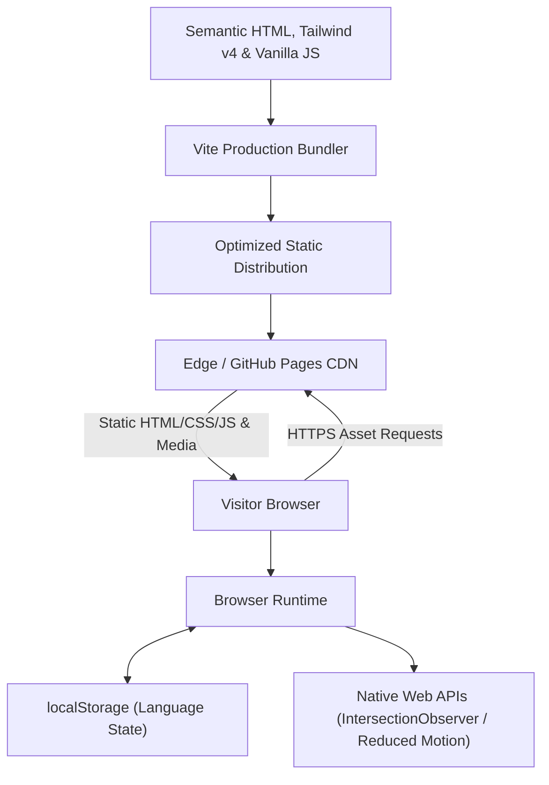

# Engineering Case Study: Static Media Product Experience

## 1. System Overview & Business Problem

This project is a high-performance, zero-backend product showcase for a mobile media application focused on local network playback. It demonstrates deliberate architectural restraint: delivering rich visual documentation, interactive usage flows, and multi-language support without the operational overhead, latency, or attack surface of a custom application server.

## 2. Infrastructure & Tech Stack

- **Core Stack:** HTML5, Vanilla JavaScript (ES6+), Tailwind CSS v4, Vite.
- **Client Persistence:** Browser `localStorage` and native Web APIs (`IntersectionObserver`, `matchMedia`).
- **Build & Delivery:** Vite production bundler with subpath resolution and automated static deployment via `gh-pages`.

## 3. Core Architectural Decisions

### 3.1 Zero-backend static delivery

**Challenge:** A product documentation and showcase site requires maximum availability, fast Time-to-First-Byte (TTFB), and minimal maintenance cost without server-side attack surfaces.

**Solution:** Built purely with semantic HTML, Tailwind CSS v4, and lightweight modular JavaScript compiled via Vite into static assets served directly from edge/CDN hosting.

**Technical Impact:** Eliminates database dependencies, server runtime vulnerabilities, and hosting overhead while achieving near-instant global load times.

### 3.2 Browser-native localization with minimal persistence

**Challenge:** Supporting multiple languages seamlessly without server-side routing or external i18n framework bloat.

**Solution:** A lightweight client module checks `localStorage` for explicit user preferences, falls back to `navigator.language`, and updates DOM data attributes, `document.documentElement.lang`, and interactive controls via a centralized translation dictionary.

**Technical Impact:** Instantaneous language switching with zero network round-trips and minimal JavaScript payload overhead.

### 3.3 Accessible progressive motion and visibility handling

**Challenge:** Scroll-triggered visual reveals must enhance presentation without blocking content access for users with reduced-motion preferences or disabled JavaScript.

**Solution:** Off-screen elements are observed via `IntersectionObserver` and unobserved immediately after revealing. The implementation respects `@media (prefers-reduced-motion: reduce)`, print stylesheets, and `<noscript>` fallbacks to ensure content is always accessible.

**Technical Impact:** Smooth visual polish paired with strict WCAG accessibility compliance and clean memory cleanup of DOM observers.

### 3.4 Accessible responsive navigation and subpath asset strategy

**Challenge:** Ensuring full keyboard navigation on mobile viewports and reliable asset resolution when hosted under repository subpaths.

**Solution:** Mobile navigation manages explicit `aria-expanded` states, focus traps, and skip-to-content links. Vite's base path configuration ensures deterministic asset URLs, while images declare explicit intrinsic dimensions and lazy loading for below-the-fold media to prevent Cumulative Layout Shift (CLS).

**Technical Impact:** Zero layout shift during media loading and full screen-reader compatibility across desktop and mobile devices.

## 4. System Architecture Diagram

## 5. Quality Assurance & Deployment

* **Performance & Accessibility Verification:** Validated against Core Web Vitals (zero CLS via explicit image dimensions, eager loading on hero assets, lazy loading on gallery media) and keyboard/screen-reader navigation standards.
* **Automated Static Publishing:** Automated `npm run deploy` hooks trigger clean Vite production builds with subpath verification prior to publishing immutable distribution branches.
